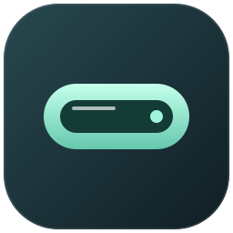

# Nafba



**Eine kleine Island für große Akku-Momente.**

Nafba ist eine native Android-App mit iOS-inspirierter Glas-Optik: ruhige Mint-Töne, feine Lichtkanten und sanfte Übergänge. Sie legt eine konfigurierbare Island über andere Apps und zeigt Akkuwarnungen sowie den Ladestatus. Entwickelt mit POCO- und Redmi-Geräten im Blick.

## V1

- Schwebende Island mit kompakter und erweiterter Ansicht; Antippen öffnet die Akkuanzeige.
- Low Battery Bar standardmäßig **unter 20 %**, frei einstellbar von 5 bis 50 %.
- Ladeanzeige statt Akkuwarnung während des Ladens.
- Breite, vertikale und horizontale Position einstellbar.
- Live-Vorschau und Vorschau der Akkuwarnung.
- Abschaltbare Animationen und eigenes Vektor-Icon.
- Kein Konto, keine Werbung, keine Analyse und keine Internetberechtigung.

## Download und Installation

Nach Veröffentlichung: [GitHub Releases](https://github.com/Fufi1925/Nafba/releases).
Lade dort die signierte `Nafba-v1.0.0.apk` herunter; die automatisch angebotenen ZIP/TAR-Dateien sind Quellcode, keine Apps.

1. Installiere die APK. Android fragt gegebenenfalls nach der Installation aus dieser Quelle.
2. Öffne Nafba, aktiviere „Island aktivieren“ und erlaube das Anzeigen über anderen Apps.
3. Kehre zurück und aktiviere die Island erneut. Erlaube die Benachrichtigung, um den aktiven Dienst bequem ausschalten zu können.
4. Passe Abstand und Position an deine Frontkamera an.

**Anforderungen:** Android 8.0+ (API 26), ohne Root. V1 ist eine erste Vorabversion; ein physischer POCO-/Redmi-Test steht aus. Das genaue Gerätemodell ist noch nicht bekannt.

## Grenzen

Nafba verändert nicht Androids Systemstatusleiste, Launcher oder Navigation. Das Overlay liegt unter geschützten Systemfenstern; Sperrbildschirm und sicherheitskritische Apps können es ausblenden. Glas ist hier eine gezeichnete Optik mit Verläufen und Lichtkanten, kein Echtzeit-Blur des Inhalts anderer Apps. Größe und Touch-Fläche des Overlays können Bedienelemente am oberen Bildschirmrand verdecken. Bei Problemen die Island ausschalten oder den Abstand erhöhen.

Unter HyperOS/MIUI können zusätzliche Einstellungen für Hintergrundaktivität, Akkuverbrauch und schwebende Fenster nötig sein. Menübezeichnungen hängen von Modell und OS-Version ab. Nach Neustart oder Beenden durch das System wird die Island bewusst nicht automatisch gestartet; öffne Nafba erneut.

## Entwicklung

Java 17, Android SDK 35, Build Tools 35.0.0, Gradle 8.13, Android Gradle Plugin 8.10.1. Keine UI-Bibliotheken; native Views und Canvas.

```sh
./gradlew testDebugUnitTest lintDebug assembleDebug
```

Die Debug-APK ist ein separat signierter Entwicklungsbuild. Für Updates der veröffentlichten App den ursprünglichen Release-Schlüssel verwenden. Anleitung: [Release-Prozess](docs/RELEASING.md).

## Projekt

- [Changelog](CHANGELOG.md)
- [Datenschutz](PRIVACY.md)
- [Mitmachen](CONTRIBUTING.md)
- [Sicherheit](SECURITY.md)
- [Gerätetest](docs/DEVICE_TESTS.md)
- [MIT-Lizenz](LICENSE)

Nafba ist ein unabhängiges Projekt von Fufi1925; keine Verbindung zu Apple, Xiaomi oder POCO. iOS und Dynamic Island sind Produkt-/Markenbezeichnungen ihrer jeweiligen Rechteinhaber.
