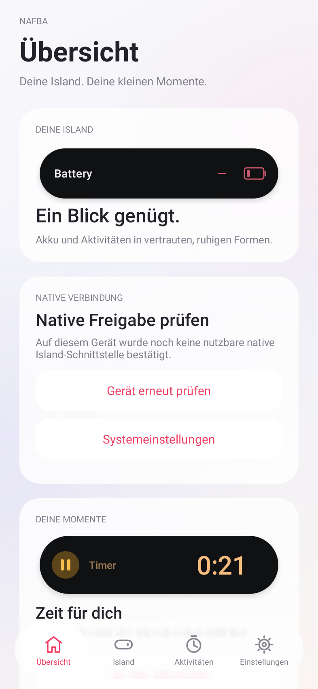
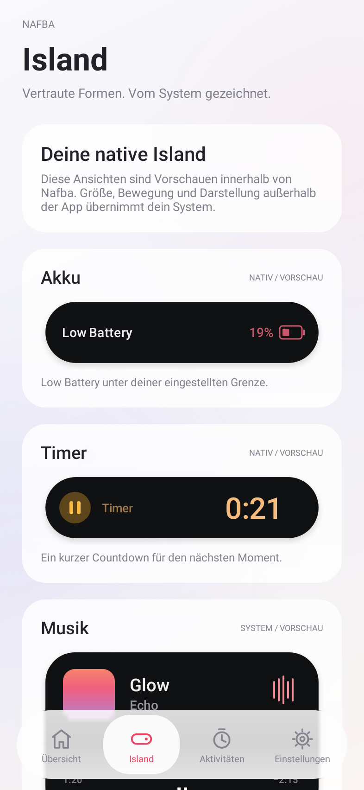

# Nafba · Native Edition

Eine Android-App mit Apple-inspirierter, schwebender Glas-Tab-Leiste und einer ausschließlich nativen Island-Anbindung.

## V2

- **Übersicht · Island · Aktivitäten · Einstellungen** als vier untere Tabs.
- Helle Glas-Flächen, rosa Akzente, sanfte Übergänge und animierte Schalter.
- Blur aus App-eigenen Inhalten; zusätzlicher Hardware-Blur ab Android 12.
- Schwarze Vorschauen für Akku, Timer, Musik, Anruf, Navigation, Fokus, Aufnahme und Laden.
- Dokumentierte Xiaomi-HyperIsland-Extras und Prüfung der lokalen Systemfreigabe.
- Kurze Timer über öffentliche Android Live Updates ab API 36.1, sofern erlaubt.
- Native Akkuwarnung unter 20 %, Grenze einstellbar, ausschließlich nach Xiaomi-Freigabe.

**Das frühere Overlay ist vollständig entfernt.** Keine `SYSTEM_ALERT_WINDOW`-Berechtigung und keine Fenster über anderen Apps. V1 bleibt nur als historischer Stand erhalten.

## Tatsächlicher Funktionsumfang

| Funktion | Voraussetzung / Status |
| --- | --- |
| Tabs, Glas-Design, Einstellungen, Vorlagen | Android 8+; unabhängig von HyperIsland |
| Eigene native Xiaomi-Island-Meldungen | Protokoll 3+, Geräteberechtigung und registrierte App-ID/Signatur/Szenario |
| Kurzer Timer | Xiaomi-Freigabe oder Android 16 QPR2 / API 36.1+ mit Promotion-Erlaubnis |
| Automatische native Akkuwarnung | Xiaomi-Freigabe; sonst bleibt der Schalter deaktiviert |
| Musik, fremde Anrufe, Navigation, Fokus, Aufnahme und Laden | interne Design-Vorschauen; keine Übernahme fremder App-Ereignisse |
| System-Island frei umgestalten oder verschieben | kein allgemeiner Styling-Zugriff implementiert |

**Die Beta enthält noch keine Xiaomi-App-ID und keine Xiaomi-Freigabe.** Eine vorhandene HyperIsland auf dem Handy allein schaltet Nafba nicht frei. Die App zeigt fehlende Unterstützung an und zeichnet niemals eine Ersatz-Island. Die Darstellung der nativen Benachrichtigungen entscheidet das System; sie muss auf dem tatsächlichen POCO-/Redmi-Gerät geprüft werden.

## Download

[Releases und APKs](https://github.com/Fufi1925/Nafba/releases). Für das korrigierte Design die **V2 Native Edition** verwenden. V1 war der verworfene Overlay-Ansatz.

1. V2-APK installieren oder V1 damit aktualisieren; der Release-Schlüssel bleibt identisch.
2. Unter **Einstellungen → Native Verbindung** das Gerät prüfen.
3. Für verfügbare native Aktivitäten Benachrichtigungen erlauben.
4. Unter **Dein Gerät** Modell, Android-Version und Build kopieren, wenn Hilfe zur Unterstützung nötig ist.

## Screenshots der tatsächlichen Android-Ansichten

 

Die Ansichten wurden mit Robolectric gerendert; sie sind keine Fotos eines POCO-Gerätetests.

## Entwicklung

Java 17 · Gradle 8.13 · AGP 8.10.1 · compile/target SDK 36 · min SDK 26.

```sh
./gradlew testDebugUnitTest lintDebug assembleDebug
```

Die Tests prüfen Akku-Grenzen, native Freigaben, die fehlende Overlay-Berechtigung, Tab-Navigation und die tatsächlichen Android-Views. Sie ersetzen keinen Hardware-Test.

Die offiziell genehmigte numerische Xiaomi-App-ID wird mit `-PxiaomiAppId=...` gesetzt. Eine ID ersetzt nicht die Signatur- und Szenariofreigabe. Keine Hidden-API- oder Permission-Bypass-Bibliotheken verwenden.

[Native Anbindung und Primärquellen](docs/NATIVE_INTEGRATION.md) · [Validierung](docs/VALIDATION.md) · [Gerätetests](docs/DEVICE_TESTS.md) · [Releases](docs/RELEASING.md) · [Changelog](CHANGELOG.md) · [Datenschutz](PRIVACY.md) · [MIT-Lizenz](LICENSE)

Unabhängiges Projekt von Fufi1925. Keine Verbindung zu Apple oder Xiaomi. Die Gestaltung ist keine Portierung von Apples Liquid-Glass-Systemframework.
